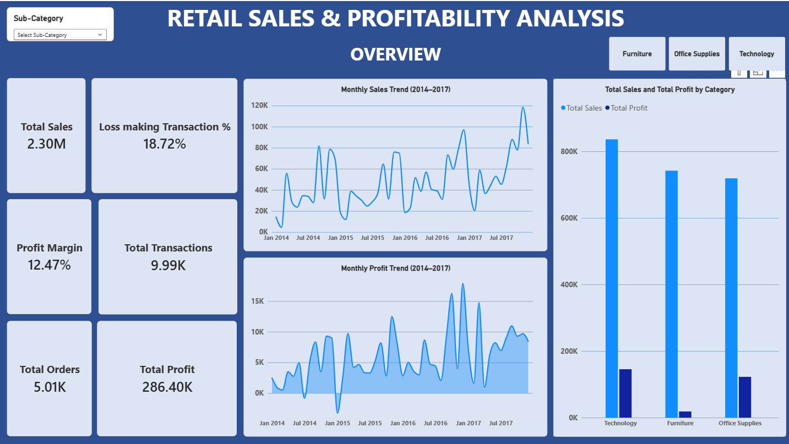
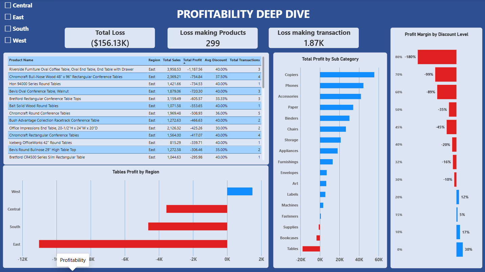
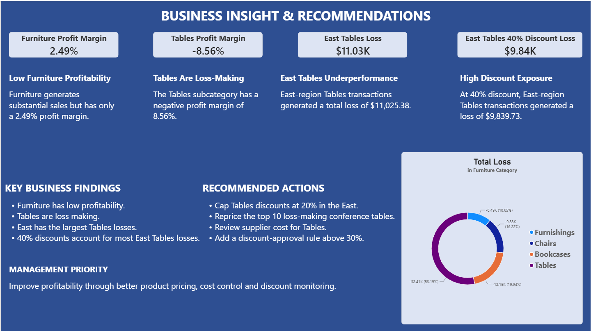

# Retail Sales & Profitability Analysis

An end-to-end data analytics project using **Python, Pandas, MySQL, and Power BI** to investigate retail sales performance, identify profitability issues, and develop actionable business recommendations.

---

## 📊 Dashboard Preview

### 1. Sales Overview

Provides an overview of sales, profit, profit margin, transactions, and monthly sales and profit trends.

### 2. Profitability Deep Dive

Investigates subcategory profitability, discount impact, regional performance, and loss-making products, with a dedicated investigation of East-region Tables products.

### 3. Business Insights & Recommendations

Summarizes the major business problems identified during the analysis and presents recommendations for improving profitability.

---

## 🎯 Project Objectives

- Analyze overall retail sales and profitability.
- Identify underperforming product categories and subcategories.
- Investigate the relationship between discounts and profitability.
- Compare regional performance.
- Identify loss-making products.
- Present actionable recommendations through an interactive Power BI dashboard.

## 🛠️ Tools & Technologies

| Tool | Purpose |
|---|---|
| Python | Data cleaning and exploratory analysis |
| Pandas | Data manipulation and preparation |
| MySQL | SQL-based business analysis |
| Power BI | Dashboard development and visualization |

## 🔄 Project Workflow

1. **Data Cleaning & Preparation:** Used Python and Pandas to inspect the dataset, check missing values and duplicates, validate data types, and prepare the cleaned dataset.
2. **Data Storage:** Imported the cleaned CSV dataset into MySQL.
3. **SQL Analysis:** Used aggregation, filtering, grouping, and business-focused queries to investigate profitability.
4. **Data Visualization:** Developed a three-page Power BI dashboard to communicate findings and recommendations.

## 🔍 Key Business Findings

| Metric | Result |
|---|---:|
| Total Sales | 2.30M |
| Total Profit | 286.40K |
| Overall Profit Margin | 12.47% |
| Total Transactions | 9,994 |
| Loss-making Transactions | 1,871 (18.72%) |
| Furniture Profit Margin | 2.49% |
| Tables Profit Margin | -8.56% |
| East-region Tables Loss | 11.03K |

### Discount Analysis

The investigation found that higher discount levels on Tables were associated with increasingly negative profitability. In the East region, transactions with a 40% discount generated a total loss of 9.84K.

*This is an observed association and does not establish that discounts alone caused the losses.*

### Product Analysis

Several Tables products recorded substantial losses. Riverside Furniture Oval Coffee Table, Oval End Table, End Table with Drawer was among the worst-performing products in the East-region investigation.

## 💡 Business Recommendations

- Review pricing and costs for low-margin Furniture products.
- Investigate loss-making Tables products individually.
- Reassess East-region pricing and promotional strategies
